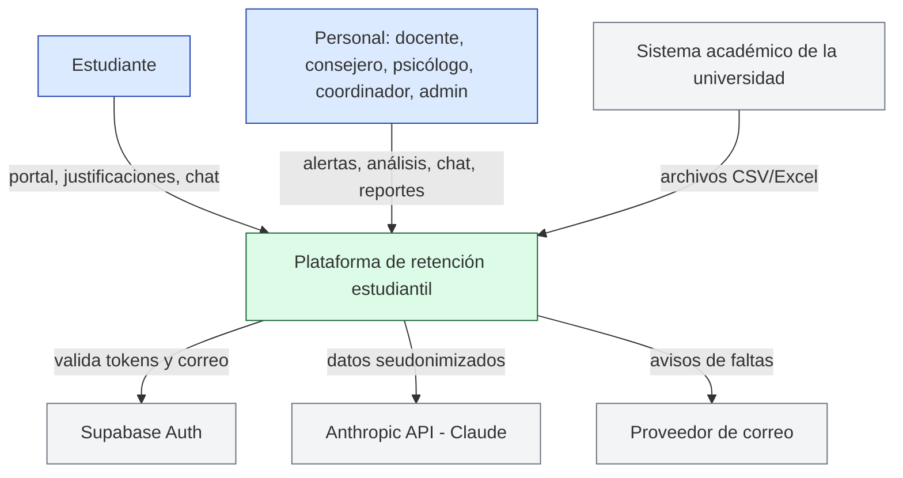
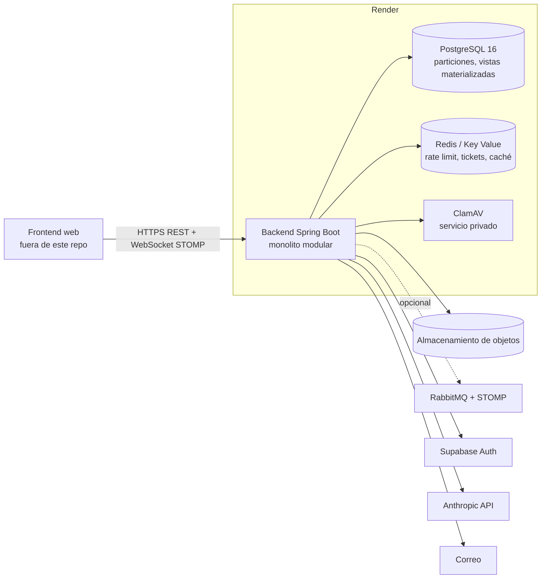
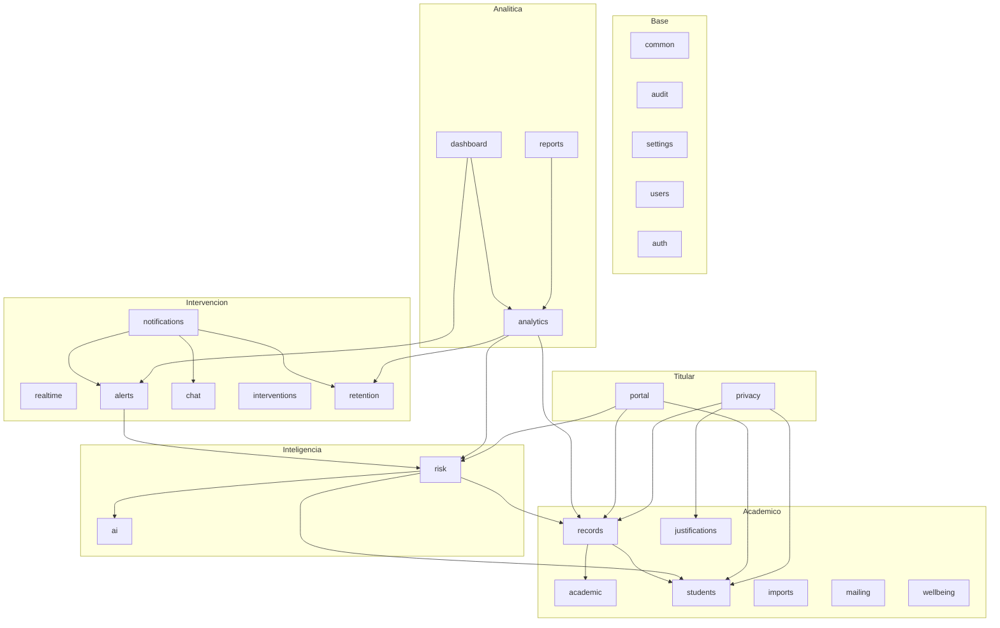

# Arquitectura (C4)

## Contexto

## Contenedores

## Componentes (módulos de Spring Modulith)

Reglas: cada módulo expone su paquete raíz (interfaces, records y eventos) y oculta sus subpaquetes; se comunican
por API pública o por eventos ([eventos.md](eventos.md)); `ModularityTest` falla si alguien cruza un límite. El
diagrama completo y verificado lo genera Spring Modulith en `target/spring-modulith-docs/` con `./mvnw verify`.
