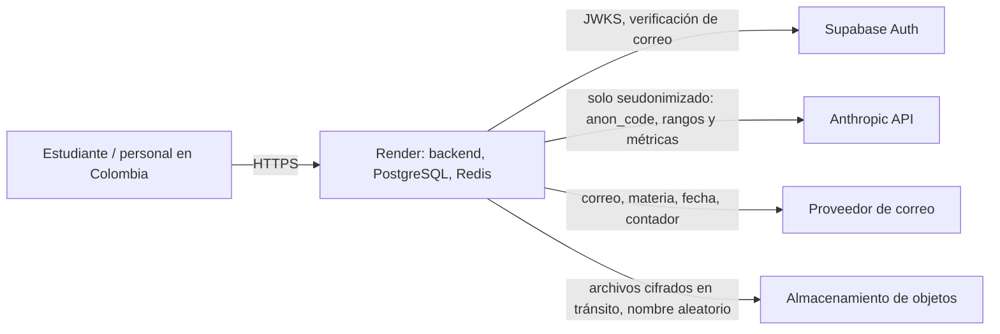

# Cumplimiento: Ley 1581 de 2012 y Decreto 1377 de 2013

Este documento resume cómo la plataforma trata los datos personales y **qué debe validar el área jurídica** antes
del piloto. No reemplaza un concepto jurídico.

## Qué hace la plataforma

| Tema | Implementación |
|---|---|
| Autorización y finalidad | Consentimientos por finalidad (`TRATAMIENTO_ACADEMICO`, `ANALITICA_RETENCION`, `BIENESTAR`, `COMUNICACIONES`) con versión de la política, canal y fecha (`/students/me/consents`) |
| Registro de actividades de tratamiento | `src/main/resources/privacy/registro-actividades.json`, servido en `GET /api/v1/privacy/processing-activities` |
| Datos sensibles | Bienestar (salud física y mental) solo para PSICOLOGO, cifrado y con lectura auditada; evidencias de salud cifradas; nunca a la IA |
| Seudonimización | Identidad separada y cifrada (`student_identities`, AES-256-GCM); todo lo demás por `anon_code`. **Es seudonimización, no anonimización**: se trata como dato personal |
| Derechos del titular | Consulta, rectificación y supresión con plazos legales (ver abajo) |
| Seguridad | Ver [seguridad-asvs.md](seguridad-asvs.md): cifrado, auditoría append-only, MFA, ABAC, mínimo necesario por rol |
| Retención | Tabla de abajo; cada módulo depura lo suyo con un job |
| Incidentes | [runbook-incidentes.md](runbook-incidentes.md), incluida la brecha de datos personales |

## Derechos del titular (`privacy`)

| Derecho | Flujo | Plazo |
|---|---|---|
| Consulta (acceso) | El estudiante radica → ADMIN aprueba → se genera en el acto una copia JSON (identidad, datos académicos, faltas, notas, justificaciones, consentimientos) que solo el titular descarga por URL de 10 minutos, disponible `privacy.export-expiry-hours` (72) | 10 días hábiles (art. 14) |
| Rectificación | Radica indicando el dato → ADMIN aprueba → corrige con los endpoints de cada módulo → registra lo hecho | 15 días hábiles (art. 15) |
| Supresión | Radica → ADMIN aprueba → **otro** ADMIN ejecuta (cuatro ojos): se borra la identidad cifrada y el perfil socioeconómico, se desvincula y desactiva el usuario, se purgan sus chats y su campanita, y el estudiante queda borrado lógicamente | 15 días hábiles (art. 15) |

Los plazos cuentan días hábiles sin festivos (`privacy.*-response-business-days`). Rechazar exige explicar el
motivo. Cada paso queda en la auditoría (`DATA_REQUEST_*`, `DATA_EXPORT_GENERATED`, `STUDENT_DATA_SUPPRESSED`) y
las vencidas disparan una alerta operativa. Una sola solicitud abierta por tipo y estudiante.

**Qué se conserva tras una supresión** (por eso jurídica debe validarlo): el registro académico seudonimizado
(asistencia, notas, historial de riesgo y casos de retención, ligados al `anon_code` sin forma de volver a la
identidad), los consentimientos (prueba de la autorización) y la auditoría (append-only, obligación de demostrar
el cumplimiento). Las evaluaciones de bienestar no se borran automáticamente: pueden estar sujetas a la normativa
de historia clínica; queda como decisión jurídica.

## Retención por tipo de dato

| Dato | Plazo | Mecanismo |
|---|---|---|
| Notificaciones | `notifications.expiry-days` (30) | job diario |
| Chat | `chat.retention-days` (730) | job diario (borrado lógico y archivos) |
| Reportes generados | `reports.expiry-hours` (24) | job horario |
| Copias del titular | `privacy.export-expiry-hours` (72) | job horario |
| Avisos de correo cerrados | `mail.outbox-retention-days` (180) | job diario |
| Registro técnico de llamadas a la IA | `ai.calls-retention-days` (365) | job diario |
| Sesiones | 24 h | expiran solas |
| Registro académico, historial de riesgo, casos | Plazo institucional (por definir) | Supresión del titular; depuración masiva pendiente de la política institucional |
| Auditoría | Permanente | append-only (trigger + permisos) |

## Flujo de datos fuera del país

No se exige alojamiento en Colombia (decisión del equipo, 2026-11-03). Todo el tratamiento ocurre fuera del país:

- **Render** (hosting, base de datos, Redis) y **Supabase** (autenticación) reciben datos personales: son
  **encargados** del tratamiento y hay **transferencia/transmisión internacional**.
- **Anthropic** recibe solo datos seudonimizados (lista blanca de campos, detector de PII, sin chat, evidencias ni
  identidad). Aun así es transmisión internacional de datos personales seudonimizados.
- El proveedor de correo y el almacenamiento de objetos están por definir.

## Qué debe validar el área jurídica

- [ ] Texto de la política de tratamiento y de cada autorización (finalidades del registro de actividades), en
      especial la autorización **explícita** para datos sensibles (bienestar, evidencias de salud).
- [ ] Contratos de transmisión/encargo con Render, Supabase, Anthropic, el proveedor de correo y el de
      almacenamiento; cláusulas de transferencia internacional y nivel adecuado de protección del país destino.
- [ ] Si el uso de IA (aun seudonimizado) requiere mención expresa en la autorización y si se habilitan
      `ai.free-text.enabled` o `ai.payload.include-sensitive-signals` (hoy apagados).
- [ ] Qué se conserva tras una supresión (registro académico, consentimientos, auditoría, bienestar).
- [ ] Plazos institucionales de retención del registro académico, del historial de riesgo y de bienestar.
- [ ] Registro de las bases de datos en el **RNBD** de la SIC (base de estudiantes, de bienestar, de personal).
- [ ] Procedimiento de reporte de incidentes de seguridad a la SIC (RNBD, 15 días hábiles) y a los titulares.
- [ ] Designación del oficial de protección de datos (hoy el rol ADMIN atiende las solicitudes).
